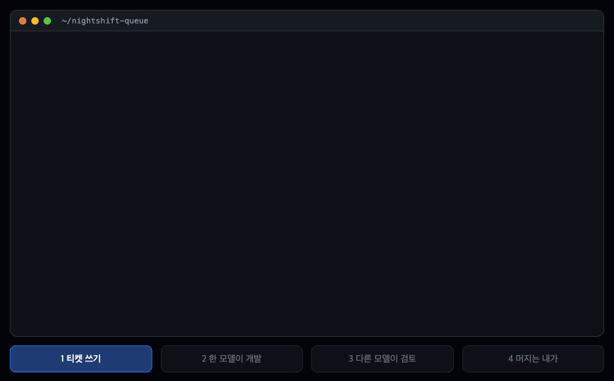
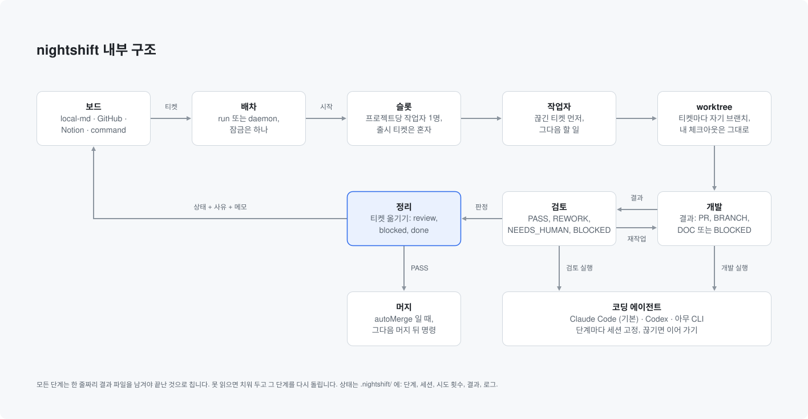
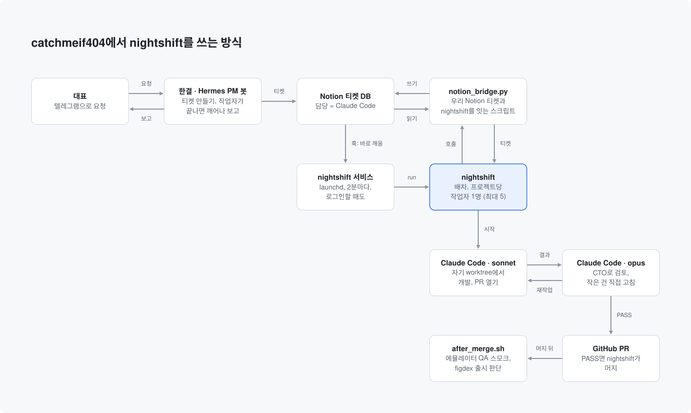

<div align="center">


<br>

**티켓을 올려 두면 한 모델이 만들고, 다른 모델이 검토하고, 사람이 정할 일만 남겨 둡니다.**

[](https://www.npmjs.com/package/@catchmeif404/nightshift)
[](https://github.com/catchmeif404/nightshift/stargazers)
[](docs/INSTALL.md)
[](LICENSE)

[English](README.md) | [한국어](README.ko.md)

<br>



<sub>실제 실행을 기다리는 시간만 잘라 재생했습니다. sonnet이 24초 만에 만들었고, opus가 33초 동안 검토하면서 개발 모델이 놓친 버그를 잡았습니다.</sub>

</div>

<br>

## 설치

```sh
npm install -g @catchmeif404/nightshift
nightshift init --repo-path ~/code/my-app
nightshift add "slugify 함수 추가" --project my-app
nightshift run
```

[10분 안에 처음 시작하기 →](docs/ko/GETTING-STARTED.md)

<br>

## 무엇인가

nightshift는 내 컴퓨터에서 도는 무인 개발 큐입니다. 보드(마크다운 파일 폴더, GitHub Issues, Notion)에 티켓을 올려
두면, nightshift가 티켓마다 코딩 에이전트의 개발 실행(기본 Claude Code `sonnet`, 또는 Codex)을 띄워 자기 브랜치에서
만들게 하고, 따로 검토 실행(기본 `opus`, Codex로도 가능)을 띄워 CTO처럼 확인하게 합니다. 작은 문제는 검토자가 직접
고치고, 큰 문제는 한 번 더 고치라고 돌려보내고, 사람이 정해야 하는 일(돈, 법률 문구, 데이터 삭제, 외부 공개)은
머지하지 않고 멈춥니다.

**nightshift는 코드를 직접 짜지 않습니다.** 만들고 검토하는 건 코딩 에이전트이고, nightshift는 아무도 안 볼 때 틀어지기
쉬운 그 주변을 맡습니다. 다음 티켓 고르기, 티켓마다 worktree 만들기, 에이전트 실행을 띄우고 끊기면 이어 가기, 실행이
남긴 결과 파일로만 끝을 인정하기, 재작업 돌려보내기, (허용하면) 통과한 것 머지하기, 티켓 상태와 메모 쓰기.

우리 제품을 만드는 러너에서 나왔고, 지금은 그 러너 자리를 대신해 우리 제품을 만들고 있습니다. 이전 bash 러너는 처음
12일 동안 **티켓 225개**를 만들고 검토했고, **84%**가 1회차 검토를 통과했습니다(통과는 AI 검토자의 판정입니다).

> 상태: 초기(0.1). 에이전트: **Claude Code**(기본)와 **Codex**, 두 역할 어디에나, 섞어서도.
> 보드: **로컬 마크다운**(기본), **GitHub Issues**, **Notion**, 그 밖의 트래커는 작은 스크립트로.

**문서:** [설치](docs/ko/INSTALL.md) · [처음 시작하기 (10분)](docs/ko/GETTING-STARTED.md) · [사용법·문제 해결](docs/ko/USAGE.md)

## 동작 방식



```
할 일 티켓 ──► 그 프로젝트의 작업자 (프로젝트당 1명, 여러 프로젝트 동시)
               │
               ├─ 빌드  (개발 모델) 전용 git worktree 에서 ─► PR <url> | BRANCH <이름> | BLOCKED <사유>
               ├─ 검토  (검토 모델) 테스트 직접 실행, 작은 건 고침 ─► PASS | REWORK | NEEDS_HUMAN | BLOCKED
               │     REWORK ─► 검토 의견을 들고 다시 빌드, 한 번 더 검토
               └─ 티켓에 반영
                        PASS ─► 사람이 머지하도록 "review" (autoMerge 면 머지)
                        NEEDS_HUMAN / BLOCKED ─► "blocked", 사유를 티켓에 남김
```

아무도 안 볼 때도 버티는 이유:

- **실행의 말이 아니라 파일을 믿습니다.** 단계는 정해진 형식의 결과 파일 한 줄을 써야 끝난 것으로 칩니다.
  못 읽는 결과는 따로 치워 두고 그 단계를 다시 돌립니다.
- **끊겨도 이어서 합니다.** 단계마다 세션 ID를 정해 두고, 재부팅·강제 종료 뒤 다음 배차가 그 세션을 이어 갑니다.
  3번 끊기면 마지막 로그 한 줄을 사유로 남기고 막힘으로 둡니다.
- **사용량 한도는 실패가 아니라 기다림입니다.** 에이전트가 "You've hit your limit · resets 3:30pm"이라고 하면 시도 횟수로
  세지 않고, 적힌 시각까지 아무것도 띄우지 않았다가 같은 세션으로 이어 갑니다.
- **서브에이전트를 쓰지 않습니다.** 단계마다 따로 실행하므로 자식을 기다리다 잘리는 일이 없습니다.
- **내 작업 폴더는 건드리지 않습니다.** 티켓마다 자기 worktree와 브랜치에서 일합니다.
- **두 모델, 두 역할.** 코드를 쓴 모델이 그 코드를 승인하지 않습니다.
- **사람이 정할 일은 사람이.** 머지는 설정한 게이트에서 멈추고, `autoMerge`는 기본으로 꺼져 있습니다.
- **믿을 수 없는 이슈는 돌리지 않습니다.** GitHub에서는 `trustedAuthors`가 연 이슈만 집습니다. 이슈는 곧 프롬프트이니까요.

## 우리가 쓰는 방식: 맥 한 대 위의 제품 팀

> 실제 사례로 보여 드리는 우리 회사 설정입니다. **여러분은 이 중 아무것도 필요 없습니다.** Hermes도, Notion도, 연결
> 스크립트도요. 마크다운 티켓 폴더나 GitHub Issues와 nightshift만 있으면 됩니다. [빠른 시작](#빠른-시작)부터 보세요.

catchmeif404는 사람 한 명과 AI 팀원들로 일합니다. 팀 보드는 Notion이고, 기획과 운영은
[Hermes Agent](https://github.com/NousResearch/hermes-agent) 위의 봇들이 cron 일정에 맞춰 하고, 개발팀이 nightshift입니다.

| 누가 | 하는 일 | 어디서 |
|---|---|---|
| 대표 | 텔레그램으로 요청하고, Notion 결정 요청 페이지에 답합니다 | 휴대폰 |
| PM 봇(한결) | 30분마다(cron) 보드·로드맵·에러 리포트를 읽고, 요청을 티켓으로 만들고, 팀원에게 나눠 주고, 후속을 챙깁니다. 텔레그램으로 보고하고, 대표가 확인할 건 Notion 링크로 알려 줍니다 | Hermes Agent |
| 마케팅·리서치·운영·출시와 정책·CS·디자인 봇 | PM이 넘긴 카드를 처리합니다: 초안, 조사, 5분 간격 에러 감시, 출시 점검, 고객 답장, 시안 | Hermes Agent |
| 개발자와 CTO | 모든 코드 티켓: `sonnet`이 자기 브랜치에서 만들고 `opus`가 검토·머지합니다. 머지 뒤 QA 스모크 테스트, 우리 앱이면 출시 판단까지 | nightshift + Claude Code |
| 보드 | 티켓, 결정 요청, 회의록, 릴리스, 지표 | Notion |

요청은 이렇게 흘러갑니다. 대표가 텔레그램에 "진열장에 정렬 버튼 추가해 줘"라고 쓰면, PM 봇이 개발 티켓으로 Notion에
올립니다. Notion 훅이 nightshift 서비스를 바로 깨우고(서비스도 2분마다 스스로 확인합니다), nightshift는 작은 연결
스크립트(`notion_bridge.py`)로 티켓을 읽어 개발·검토 실행을 돌리고, PR을 머지한 뒤 PM 봇의 cron을 깨웁니다. PM 봇은
티켓에 남은 결과를 읽고 텔레그램으로 대표에게 알립니다(Notion 링크와 함께). 대표만 정할 수 있는 일(돈, 법률 문구, 외부 공개)은 결정 요청 페이지가 되고,
대표가 댓글로 답하면 PM 봇이 티켓을 다시 큐에 넣습니다. nightshift는 예전에 쓰던 bash 러너를 대신하고 있고,
`nightshift service uninstall` 하나로 코드 작업 전체를 멈춥니다.



## 빠른 시작

Node 20 이상, git, 로그인된 [Claude Code](https://docs.anthropic.com/en/docs/claude-code) CLI가 필요합니다.

전체 따라 하기는 [처음 시작하기](docs/ko/GETTING-STARTED.md)에 있습니다.

```sh
npm install -g @catchmeif404/nightshift
mkdir ~/nightshift-queue && cd ~/nightshift-queue
nightshift init --repo-path ~/code/my-app
nightshift doctor
nightshift add "slugify 함수 추가" --project my-app --body "소문자, 대시, 기존 테스트 옆에 테스트"
nightshift run                     # 작업자를 백그라운드로 띄우고 바로 끝남
nightshift logs -f                 # 지켜보기
nightshift status                  # 상태별 티켓
nightshift service install         # 이제부터 새 티켓을 알아서 가져감 (2분마다)
nightshift ui                      # 로컬 웹 콘솔: 현황, 설정, doctor
```

로컬 보드에서는 티켓이 `.tickets/` 안의 파일이고, 러너가 `ready → working → review | blocked → done` 으로 옮기며
각 파일에 메모를 덧붙입니다.

### GitHub Issues

```sh
nightshift init --board github --repo you/my-app --repo-path ./my-app
```

설정 파일을 쓰고, `nightshift:*` 라벨을 만들고, 로그인한 `gh` 사용자를 믿을 수 있는 작성자로 넣습니다(더하려면
`--trusted a,b`). 그다음 이슈에 `nightshift:ready` 라벨을 달면 됩니다. 작업자가 PR을 열고, 검토자가 검토하고, 이슈가 `nightshift:review`로 갑니다
(`autoMerge`면 머지되고 닫힙니다). 혼자 돌아야 하는 티켓에는 `nightshift:release`를 답니다.

### 다른 트래커 (command 보드)

Notion은 내장 보드가 있습니다([설정](docs/ko/USAGE.md#notion을-보드로)). Linear, Jira, 스프레드시트 등은
`board.command`에 작은 스크립트를 지정하면 보드로 씁니다. 스크립트는
`list <상태>`(티켓 JSON 배열 출력), `set-status <id> <상태> <사유>`, `note <id>`(메모는 stdin) 세 명령만 알면 됩니다.
사유(`needs-human`, `merged`, `cut-off` 등)를 보고 결정 요청 페이지를 여는 식으로 트래커 쪽 동작을 붙일 수 있습니다.
`language: "ko"`로 두면 러너가 티켓에 남기는 메모가 한국어가 됩니다.

설정 키 전체는 [영어 README](README.md#config-nightshiftjson)에 있습니다. 티켓 본문에 `결과물:`, `확인 방법:` 같은 항목을 꼭 넣게 하려면 `ticketSections`를 쓰세요(기본 꺼짐, [설명](docs/ko/USAGE.md)). 정해진 경로(예: `db/migration/**`)가 바뀌면 검토 결과와 상관없이 사람에게 넘기려면 `gatePaths`를 쓰세요(기본 꺼짐, 같은 문서).

## 안전

nightshift는 worktree 안에서 파일을 고치고 명령을 실행할 권한으로 코딩 에이전트를 무인 실행합니다. 그래도 괜찮은
컴퓨터와 저장소에서 돌리고, 믿을 수 있을 때까지 `autoMerge`는 끄고, `trustedAuthors`는 짧게 두세요. 쓰는 에이전트
서비스의 약관이 무인 실행을 허용하는지도 확인하세요.

## 함께 쓰는 것

<table>
<tr><td width="200"><b><a href="https://docs.anthropic.com/en/docs/claude-code">Claude Code</a></b><br>Anthropic</td><td>기본 개발자(<code>sonnet</code>)와 검토자(<code>opus</code>).</td></tr>
<tr><td width="200"><b><a href="https://github.com/openai/codex">Codex CLI</a></b><br>OpenAI</td><td>어느 역할이든, Claude Code와 섞어서도.</td></tr>
<tr><td width="200"><b><a href="https://github.com/NousResearch/hermes-agent">Hermes Agent</a></b><br>Nous Research</td><td><a href="#우리가-쓰는-방식-맥-한-대-위의-제품-팀">우리가 쓰는 방식</a>의 PM 봇과 다른 팀원들을 돌립니다. nightshift를 쓰는 데는 필요 없습니다.</td></tr>
</table>

nightshift는 독립 프로젝트이며 Anthropic, OpenAI, Nous Research와 관계가 없습니다.

## 함께해요

> [!TIP]
> 아직 0.1입니다. 써 보시고 어디서 막히는지 알려 주시는 게 지금 가장 큰 도움이 됩니다.
>
> <table>
> <tr><td width="140"><a href="https://github.com/catchmeif404/nightshift/issues"></a></td><td>어디서 막혔는지, 뭐가 필요한지, 어떻게 쓰고 계신지. 이슈는 전부 읽습니다.</td></tr>
> <tr><td width="140"><a href="https://github.com/catchmeif404/nightshift"></a></td><td>쓸 만하다면 스타 하나가 다른 사람이 찾는 데 도움이 됩니다.</td></tr>
> <tr><td width="140"><a href="https://github.com/catchmeif404"></a></td><td><a href="https://github.com/catchmeif404">catchmeif404</a>의 릴리스와 다른 프로젝트.</td></tr>
> </table>

## 라이선스

MIT
