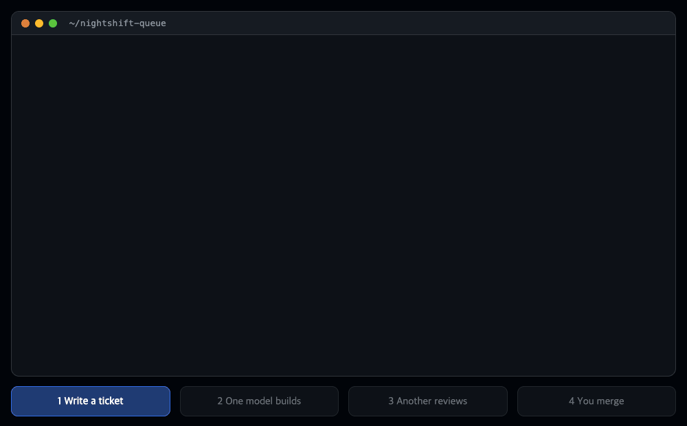
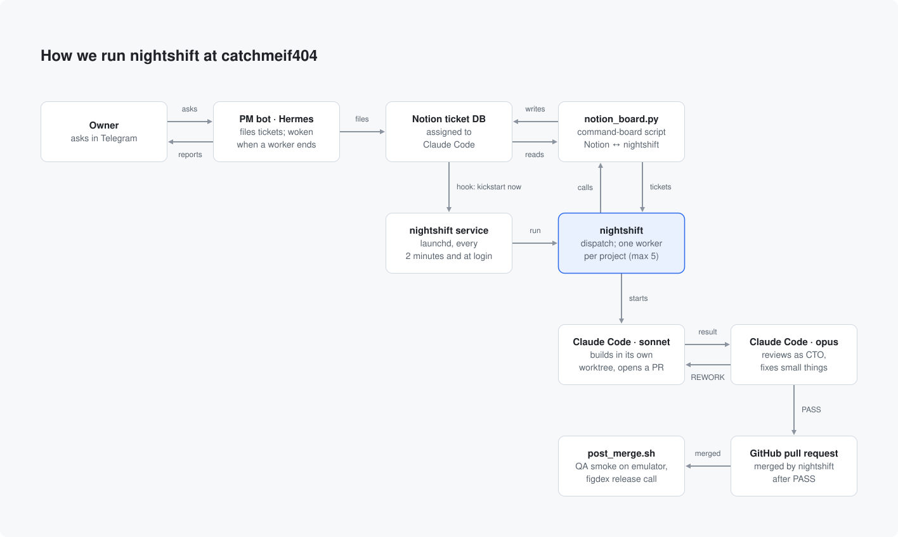
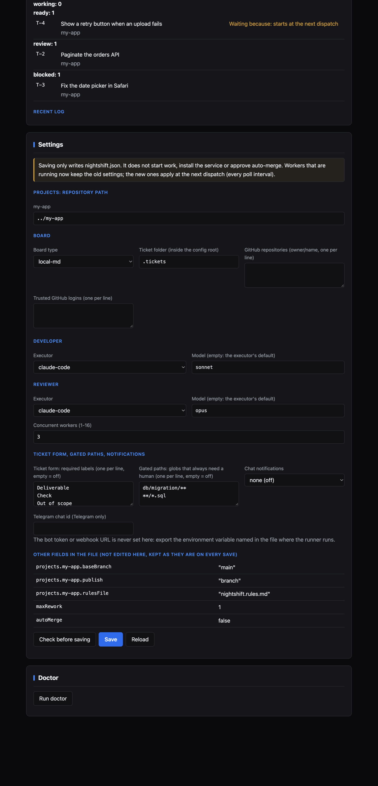

<div align="center">


<br>

**Tickets in. One model builds, another reviews. You only decide what a human must.**

[](https://www.npmjs.com/package/@catchmeif404/nightshift)
[](https://github.com/catchmeif404/nightshift/stargazers)
[](docs/INSTALL.md)
[](LICENSE)

[English](README.md) | [한국어](README.ko.md)

<br>



<sub>A real run, replayed with the waiting cut out: sonnet built it in 24 seconds, opus reviewed it in 33 and caught a bug the builder missed.</sub>

</div>

<br>

## Install

```sh
npm install -g @catchmeif404/nightshift
nightshift init --repo-path ~/code/my-app
nightshift add "Add a slugify helper" --project my-app
nightshift run
```

[Getting started in 10 minutes →](docs/GETTING-STARTED.md)

<br>

## What it is

nightshift is an unattended dev queue that runs on your own machine. Put tickets on a board (a folder of markdown
files, GitHub Issues or Notion) and walk away. For each ticket nightshift starts a developer run of a coding agent
(Claude Code `sonnet` by default, or Codex) that builds it on its own branch, then a separate reviewer run (`opus` by
default) that checks it like a CTO would: it fixes small things, sends bigger ones back for one more round, and stops
anything that needs a human (money, legal text, destructive data changes, public actions) instead of merging it.

**nightshift writes no code itself.** The coding agents do the building and reviewing; nightshift is the part around
them that is easy to get wrong when nobody is watching: it picks the next ticket, gives each one its own worktree,
starts and resumes the agent runs, accepts a result only from the file the run must write, sends work back for rework,
merges what passed (if you let it), and keeps the ticket up to date.

It grew out of the runner that builds our own products, and it now runs them. Its bash predecessor took
**225 tickets** through build and review in its first 12 days; **84%** passed review on the first round
(the pass is the AI reviewer's verdict, not a human's).

> Status: early (0.1). Agents: **Claude Code** (default) and **Codex**, in either role, mixed as you like.
> Boards: **local markdown** (default), **GitHub Issues**, **Notion**, and any other tracker through a small script.

**Docs:** [Install](docs/INSTALL.md) · [Getting started (10 minutes)](docs/GETTING-STARTED.md) · [Usage and troubleshooting](docs/USAGE.md)

## How it works


```
ticket ready ──► worker for that project (one per project, a few projects at once)
                 │
                 ├─ build   (developer model) in its own git worktree ─► writes: PR <url> | BRANCH <name> | BLOCKED <why>
                 ├─ review  (reviewer model) runs the tests, fixes small things ─► writes: PASS | REWORK | NEEDS_HUMAN | BLOCKED
                 │     REWORK ─► build again with the review notes, then review once more
                 └─ update the ticket
                            PASS ─► "review" for you to merge (or merged, with autoMerge on)
                            NEEDS_HUMAN / BLOCKED ─► "blocked", with the reason on the ticket
```

What makes it hold up when nobody is watching:

- **Runs are not trusted, files are.** A stage counts as done only when it writes its one-line result file in the
  expected format. A result it cannot read is set aside and the stage runs again.
- **Cut-off runs resume.** Each stage gets a fixed session id; after a reboot or a killed process the next dispatch
  resumes that same session. After 3 cut-offs the ticket is blocked with the last log line as the reason.
- **Usage limits wait instead of failing.** When the agent says "You've hit your limit · resets 3:30pm", nightshift
  does not count it as a try: it starts nothing until the stated reset, then resumes the same session.
- **No subagents, no waiting.** Every stage is its own CLI run, so nothing sits waiting on a child until it times out.
- **Your checkout is never touched.** Every ticket works in its own worktree on its own branch.
- **Two models, two roles.** The one that wrote the code is not the one that approves it.
- **Humans decide human things.** Merging stops at the gates you configure, and `autoMerge` is off by default.
- **Untrusted issues never run.** On GitHub only issues opened by `trustedAuthors` are picked up: an issue is a prompt.

## How we run it: a product team on one Mac

> This is our own setup, shown as a real-world example. **You need none of it**: no Hermes, no Notion, no bridge
> script. nightshift on its own, with a folder of markdown tickets or GitHub Issues, is the whole product; start with
> [Quick start](#quick-start).

catchmeif404 is one person and a team of AI teammates. Notion is the team's board, bots on
[Hermes Agent](https://github.com/NousResearch/hermes-agent) do the planning and the day-to-day work on cron
schedules, and nightshift is the development team.

| Who | What they do | Runs on |
|---|---|---|
| The owner | asks for things in Telegram, answers decision pages in Notion | a phone |
| PM bot | every 30 minutes (a cron job): reads the board, roadmap and error reports, turns requests into tickets, hands work to teammates, follows up; reports in Telegram, with a Notion link for anything the owner has to check | Hermes Agent |
| Marketing, research, ops, release and policy, support, design bots | the cards the PM hands them: drafts, research, a 5-minute error watch, release checks, support replies, mockups | Hermes Agent |
| Developer and CTO | every code ticket: `sonnet` builds it on its own branch, `opus` reviews and merges; after a merge, a QA smoke test and, for our app, the release call | nightshift + Claude Code |
| The board | tickets, decision pages, meeting notes, releases, metrics | Notion |

A request goes like this. The owner writes "add sorting to the shelf" in Telegram. The PM bot files it in Notion as a
ticket for the developers. A Notion hook kicks the nightshift service right away (it also checks every 2 minutes on its
own); nightshift reads the ticket through a small bridge script (`notion_bridge.py`), the builder and the reviewer do
their runs, the pull request is merged, and nightshift wakes the PM bot's cron job, which reads the result on the ticket
and tells the owner in Telegram, with a link to the Notion page. Anything only the owner can decide (money, legal text, anything public) becomes a decision page
instead; the owner answers in a comment and the PM bot puts the ticket back in the queue. nightshift replaced the bash
runner we used before; `nightshift service uninstall` stops all code work.



## Quick start

Needs Node 20+, git, and the [Claude Code](https://docs.anthropic.com/en/docs/claude-code) CLI signed in.
The full walk-through is [Getting started](docs/GETTING-STARTED.md).

```sh
npm install -g @catchmeif404/nightshift
mkdir ~/nightshift-queue && cd ~/nightshift-queue
nightshift init --repo-path ~/code/my-app
nightshift doctor
nightshift add "Add a slugify helper" --project my-app --body "lowercase, dashes, tests next to the existing ones"
nightshift run                     # starts workers in the background and returns
nightshift logs -f                 # watch them
nightshift status                  # tickets by status
nightshift service install         # from now on, picks up new tickets on its own (every 2 minutes)
nightshift ui                      # a local web console: status, settings, doctor
```

With the local board, tickets are files in `.tickets/`; the runner moves them through
`ready → working → review | blocked → done` and appends notes to each file. Finished work waits on a local branch
(`nightshift/t-1`) for you to merge. `service install` registers a LaunchAgent (macOS) or systemd timer (Linux):
see [running continuously](docs/USAGE.md#running-continuously).

### The console (`nightshift ui`)

You can also configure nightshift from the dashboard. `nightshift ui` opens a local web console
(127.0.0.1 only) that shows running workers and tickets by status, with why each ready ticket is still waiting, and
lets you edit the settings: repository paths, board, builder and reviewer, concurrent workers, ticket form, gated
paths and chat notifications. It checks your changes before saving and only writes `nightshift.json`: it never starts
work. A doctor button runs the same checks as `nightshift doctor`. More in [the console](docs/USAGE.md#the-local-console-nightshift-ui).

<p align="center">

</p>

### GitHub Issues

```sh
nightshift init --board github --repo you/my-app --repo-path ./my-app
```

This writes the config, creates the `nightshift:*` labels and trusts the signed-in `gh` user (more with
`--trusted a,b`). Then label an issue `nightshift:ready`. The worker opens a pull request, the reviewer reviews it, and the issue moves to
`nightshift:review` (or gets merged and closed with `autoMerge`). Add `nightshift:release` to make a ticket run alone.

## Config (`nightshift.json`)

| key | default | what it does |
|---|---|---|
| `board.type` | `local-md` | `local-md` (folder of tickets), `github`, `notion` ([setup](docs/USAGE.md#notion-as-the-board)), or `command` (any tracker, see below) |
| `board.notion` | | database id, token, property and status names: see [Notion as the board](docs/USAGE.md#notion-as-the-board) |
| `board.command` | none | for `command`: the executable that speaks the board protocol |
| `board.repos`, `board.trustedAuthors` | `[]` | GitHub repos to read, and whose issues may run |
| `projects.<name>.repoPath` | (required) | the repo a ticket of this project works in |
| `projects.<name>.publish` | `pr` | `pr` pushes and opens a pull request; `branch` leaves a local branch |
| `projects.<name>.rulesFile` | none | house rules added to every prompt for this project |
| `projects.<name>.postMergeCommand` | none | runs after a merge; its result is noted on the ticket |
| `builder`, `reviewer` | Claude Code `sonnet` / `opus` | `type` (`claude-code`, `codex` or `command`), `model`, `permissionMode` (Claude Code), `sandbox` (Codex: `auto`, `workspace-write`, `read-only`, `danger-full-access`) |
| `pollSeconds` | 120 | how often the service and `daemon` look for work (at least 30) |
| `maxSlots` | 3 | projects worked at the same time |
| `maxRework` | 1 | extra build-and-review rounds after a REWORK |
| `maxStageTries` | 3 | cut-offs before a ticket is blocked (usage limits are not counted) |
| `usageLimitWaitMinutes` | 60 | how long to wait after a usage limit whose message gives no reset time |
| `autoMerge` | `false` | merge pull requests that pass review |
| `reviewHandoff` | `false` | experimental: the developer writes a handoff (summary, changed files, test results) and the reviewer gets it with git's list of changed files, instead of surveying the repo again; off leaves the prompts unchanged |
| `humanGates` | all five | `money`, `legal`, `destructive-data`, `outward-facing`, `product-direction` |
| `ticketSections` | `[]` | labels such as `["Deliverable","Check","Out of scope"]`; a ticket body without a `Label: text` line for each is blocked before it runs, and the prompts list them |
| `gatePaths` | `[]` | globs such as `["db/migration/**", "**/*.sql"]`; if the change against the base branch touches a file matching one, a passing review becomes `NEEDS_HUMAN` and nothing is merged, even with `autoMerge` |
| `notify` | off | built-in Telegram / Slack / Discord messages: `service`, `events` (`review`, `blocked`, `merged`), env-var names `botTokenEnv` / `webhookUrlEnv` (never the secret), `chatId`; see [Usage](docs/USAGE.md) |
| `notifyCommand` | none | gets one message as its last argument when a ticket is blocked |
| `workerDoneCommand` | none | shell command run each time a worker finishes |
| `language` | `en` | language of the notes on tickets: `en` or `ko` |

A `command` agent is any executable: it gets the prompt on stdin and `NIGHTSHIFT_MODEL`, `NIGHTSHIFT_SESSION_ID`,
`NIGHTSHIFT_SESSION_MODE` (`new` or `resume`) in its environment.

## Any tracker: the command board

Linear, Jira, a spreadsheet, or a Notion setup the built-in board does not fit: point `board.command` at a small
script and nightshift uses it as the board.

```
<command> list <status>                      print a JSON array: [{"id","title","body","project","kind","createdAt"}]
<command> set-status <id> <status> <reason>  the note comes on stdin
<command> note <id>                          the note comes on stdin
```

Statuses are `ready`, `working`, `review`, `blocked`, `done`; `kind` is `build` or `release`. The reason tells the
tracker why a ticket moved (`needs-human`, `merged`, `cut-off`, ...), so it can, say, open a decision page for
`needs-human`. Exit non-zero on failure. Tickets the script does not want run, it simply does not list.

## Release tickets

A ticket of kind `release` runs alone, as one run of the reviewer model that follows the project's rules file
(tag, deploy, verify). It writes `DONE <what and how it was verified>` or `BLOCKED <why>`.

## Safety

nightshift runs coding agents unattended with permission to edit files and run commands in a worktree. Run it on a
machine and repositories you are fine with that on, keep `autoMerge` off until you trust it, and keep
`trustedAuthors` short. Check that unattended use fits the terms of the agent service you use.

## Built on

<table>
<tr><td width="200"><b><a href="https://docs.anthropic.com/en/docs/claude-code">Claude Code</a></b><br>by Anthropic</td><td>The default developer (<code>sonnet</code>) and reviewer (<code>opus</code>).</td></tr>
<tr><td width="200"><b><a href="https://github.com/openai/codex">Codex CLI</a></b><br>by OpenAI</td><td>Either role, mixed with Claude Code as you like.</td></tr>
<tr><td width="200"><b><a href="https://github.com/NousResearch/hermes-agent">Hermes Agent</a></b><br>by Nous Research</td><td>Runs the PM bot and the other teammates in <a href="#how-we-run-it-a-product-team-on-one-mac">How we run it</a>. Not needed to use nightshift.</td></tr>
</table>

nightshift is an independent project and is not affiliated with Anthropic, OpenAI or Nous Research.

## Be with us

> [!TIP]
> It's early (0.1). Trying it and telling us where it breaks is the most useful thing you can do right now.
>
> <table>
> <tr><td width="140"><a href="https://github.com/catchmeif404/nightshift/issues"></a></td><td>Where it breaks, what you need, how you run it. Every issue is read.</td></tr>
> <tr><td width="140"><a href="https://github.com/catchmeif404/nightshift"></a></td><td>If it's useful, a star helps others find it.</td></tr>
> <tr><td width="140"><a href="https://github.com/catchmeif404"></a></td><td>Releases and our other projects from <a href="https://github.com/catchmeif404">catchmeif404</a>.</td></tr>
> </table>

## License

MIT
